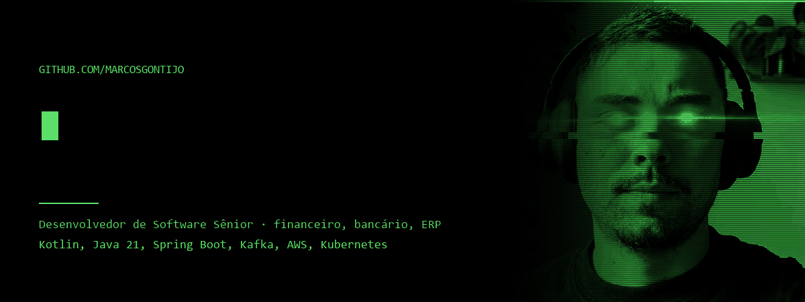
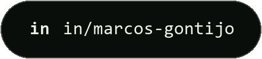
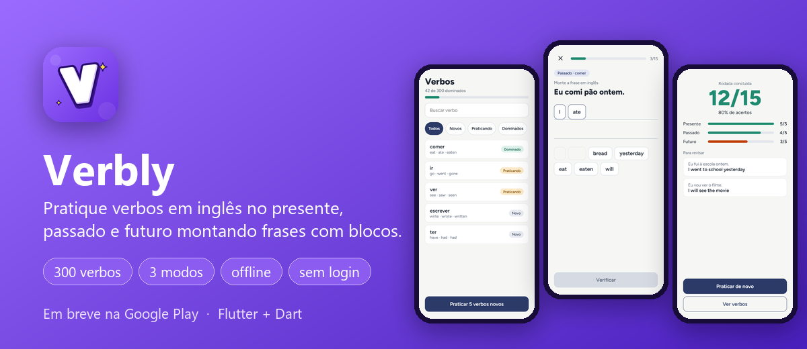

  

  
  
  
  

---

Desenvolvedor de Software Sênior em Campinas, SP, com quase 5 anos construindo backends para os setores financeiro, bancário, ERP e utilities. Hoje estou na **Cora**, no time interno de engenharia: entrei como consultor pela Stefanini e fui internalizado pelo resultado que entreguei no projeto.

No dia a dia escrevo **Kotlin** e **Java 21** com **Spring Boot**, desenho integrações assíncronas com **Apache Kafka** e **AWS SQS**, e coloco tudo para rodar em **Docker** e **Kubernetes**, com observabilidade em **Grafana** e **Datadog**. Antes disso, passei pelo core bancário da **Matera**, pelo fullstack Java + Angular no **Galleria Bank** e pela construção do zero de uma plataforma para concessionárias de energia na **Kaffa Tech**.

Fora do horário, estudo arquitetura de microsserviços e como colocar **agentes de IA** para trabalhar com regras claras: testes congelados, revisão independente e nenhum agente aprovando o próprio trabalho.

E nas horas vagas estou desenvolvendo e publicando o meu próprio app: o **Verbly**, que está chegando à Google Play.

## Lançando agora: Verbly

  

**[Verbly](https://marcosgontijo.github.io/verbly-site/testadores/)** · App Android que criei do zero para praticar verbos em inglês no presente, passado e futuro, montando a tradução com blocos de palavras. Nasceu de uma necessidade minha: meu professor passou uma lista enorme de verbos e eu queria praticar com correção automática.

 

- **300 verbos e 1.500 conjuntos de frases**, além de dois modos extras: *noun adjuncts* ("a box of shoes" → "a shoe box") e perguntas com *do/does*
- **Offline e sem login:** validação local, sem backend, sem anúncios e sem coleta de dados; o progresso fica salvo no aparelho (SQLite)
- Ouve a frase em inglês com a voz do aparelho (TTS), feedback do erro e status de cada verbo: novo, praticando, dominado
- **Flutter + Dart** com Riverpod, arquitetura MVC por feature e regras de negócio como funções puras com testes unitários; o conteúdo é gerado e validado por um pipeline em Python
- Desenvolvido com Claude Code, com agentes de teste e de segurança revisando as entregas
- **Status:** em teste fechado na Play Store antes do lançamento. Tem Android? [Seja um testador →](https://marcosgontijo.github.io/verbly-site/testadores/) · [Política de privacidade](https://marcosgontijo.github.io/verbly-site/)

## Destaques

- **Integrações de alta volumetria:** APIs de integração com o ERP Matera, Serasa e Fácil; os fluxos de cadastro de clientes bancários e emissão de nota fiscal rodam via **Kafka** pelo volume de dados
- **Core bancário:** evolução e sustentação dos módulos de compensação, convênios, cartões e virada de dia na Matera (Java, Spring Boot e PL/SQL)
- **Produto do zero:** solução de monitoramento de materiais e ativos elétricos integrada ao **ArcGIS**, usada por concessionárias como a Neoenergia, com fluxos em **Camunda BPM** e CI/CD em **HashiCorp Nomad**
- **Fullstack quando precisa:** sistemas internos bancários com **Angular + PrimeNG** no front e Spring Boot + Kafka no back
- Tecnólogo em **Análise e Desenvolvimento de Sistemas**, Wyden Unimetrocamp (2019 a 2022)
- Cidadania italiana, elegível para trabalhar na União Europeia

## Construindo agora

- **[agentes-loop](https://github.com/marcosgontijo/agentes-loop)** · Loop de agentes para o Claude Code: analista, developer, tester, reviewer e finalizador. A tarefa só termina quando três sinais independentes concordam (gate de testes, review e veredito). Usado para migrar o CorteCerto de Angular para Flutter: 3 fases, 502 testes no fim.
- **[CorteCerto Mobile](https://github.com/marcosgontijo/cortecerto_app_flutter)** · App Flutter de agendamento para barbearias, com API REST em Java Spring Boot, login JWT, agenda em tempo real e bloqueio automático de horários ocupados.
- **[estudo_kafka](https://github.com/marcosgontijo/estudo_kafka)** · Microsserviços com o padrão Saga orquestrado: Java 17, Spring Boot 3, Apache Kafka, PostgreSQL, MongoDB e Docker.

Também por aqui: [crud-go](https://github.com/marcosgontijo/crud-go), [robo_apontamento](https://github.com/marcosgontijo/robo_apontamento-), [curso-angular](https://github.com/marcosgontijo/curso-angular). [Todos os repositórios →](https://github.com/marcosgontijo?tab=repositories)

## Stack

- **Linguagens:** Kotlin, Java (8 a 22), TypeScript, Python, Go, Dart, PL/SQL
- **Frameworks:** Spring Boot, Spring Data JPA, Spring Security, Spring Cloud, Angular, PrimeNG, Flutter
- **Mensageria & dados:** Apache Kafka, AWS SQS, AWS S3, PostgreSQL, Oracle, MongoDB, SQLite
- **Infra & observabilidade:** Docker & Compose, Kubernetes, LocalStack, HashiCorp Nomad, Jenkins, Grafana, Datadog
- **Processos & ferramentas:** Camunda BPM, ArcGIS, Git (GitHub/GitLab), Maven, Gradle, Postman, DBeaver
- **Qualidade:** JUnit, Mockito, TestNG
- **Segurança:** OAuth 2.0, JWT

## Vamos conversar

Aberto a conversas sobre backend, integrações, mensageria e projetos com agentes de IA. Respondo rápido.

[marcoseduardogontijo@gmail.com](mailto:marcoseduardogontijo@gmail.com) · [LinkedIn](https://www.linkedin.com/in/marcos-gontijo-46a451148/)
