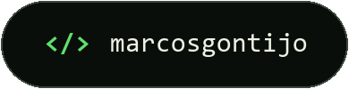

  

  
  
  
  

---

Desenvolvedor Back-End Pleno em Campinas, SP. Mais de 5 anos e meio no mercado de tecnologia, hoje na **KAFFA**, no time de implantação e customização de produto. Escrevo **Java 8** e **Kotlin** em produtos corporativos, orquestro jobs com **Nomad** e workflows com **Camunda BPM**, e faço a ponte entre sistemas: integrações REST e **SAP**, PostgreSQL, Oracle e SQLite por baixo de tudo.

Fora do horário, estudo arquitetura de microsserviços, mensageria com Kafka e como colocar **agentes de IA** para trabalhar com regras claras: testes congelados, revisão independente e nenhum agente aprovando o próprio trabalho.

## Destaques

- **+5 anos e meio** em produção: APIs REST, microsserviços, integrações corporativas e análise de dados
- Backend em **Java & Kotlin** com testes unitários e mocks, rodando em pipelines de CI/CD
- Integrações **SAP / REST** e orquestração de processos com **Camunda BPM** e **Nomad Hashicorp**
- Tecnólogo em **Análise e Desenvolvimento de Sistemas**, Wyden Unimetrocamp (2019 a 2022)

## Construindo agora

- **[agentes-loop](https://github.com/marcosgontijo/agentes-loop)** · Loop de agentes para o Claude Code: analista, developer, tester, reviewer e finalizador. A tarefa só termina quando três sinais independentes concordam (gate de testes, review e veredito). Usado para migrar o CorteCerto de Angular para Flutter: 3 fases, 502 testes no fim.
- **[CorteCerto Mobile](https://github.com/marcosgontijo/cortecerto_app_flutter)** · App Flutter de agendamento para barbearias, com API REST em Java Spring Boot, login JWT, agenda em tempo real e bloqueio automático de horários ocupados.
- **[Verbly](https://marcosgontijo.github.io/verbly-site/)** · App próprio; o site público com a política de privacidade fica em [verbly-site](https://github.com/marcosgontijo/verbly-site).
- **[estudo_kafka](https://github.com/marcosgontijo/estudo_kafka)** · Microsserviços com o padrão Saga orquestrado: Java 17, Spring Boot 3, Apache Kafka, PostgreSQL, MongoDB e Docker.

Também por aqui: [crud-go](https://github.com/marcosgontijo/crud-go), [robo_apontamento](https://github.com/marcosgontijo/robo_apontamento-), [curso-angular](https://github.com/marcosgontijo/curso-angular). [Todos os repositórios →](https://github.com/marcosgontijo?tab=repositories)

## Stack

- **Linguagens:** Java, Kotlin, TypeScript, Python, Go, Dart
- **Frameworks:** Spring Boot, Spring Data JPA, Spring Security, Spring Cloud, Angular, Flutter
- **Dados:** PostgreSQL, Oracle, SQLite, MongoDB, Kafka
- **Infra & ferramentas:** Docker & Compose, Jenkins, Nomad, Camunda, Git, Postman, DBeaver, Lombok
- **Segurança:** OAuth 2.0, JWT

## Vamos conversar

Aberto a conversas sobre backend, integrações e projetos com agentes de IA. Respondo rápido.

[marcoseduardogontijo@gmail.com](mailto:marcoseduardogontijo@gmail.com) · [LinkedIn](https://www.linkedin.com/in/marcos-gontijo-46a451148/)
